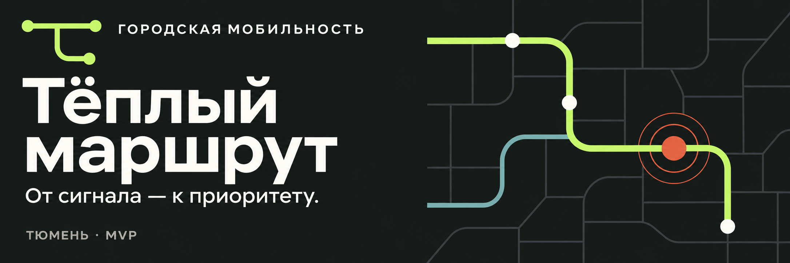

# Решение кейса T2 «Тёплый маршрут»

Прототип системы приоритизации зимних городских проблем. Объединяет обращения, погоду, транспортные данные и модельную мобильность, рассчитывает объяснимый Impact Score и показывает результат на карте диспетчера.

- [Описание конкурсного кейса](docs/CASE.md)
- [Исследование и концепция решения](docs/RESEARCH.md)
- [Архитектура и реализованные возможности](docs/ARCHITECTURE.md)
- [Запуск, настройка и проверка MVP](mvp/README.md)
