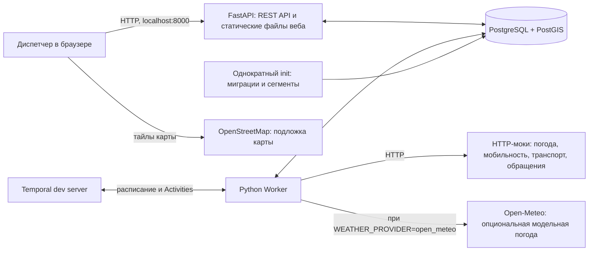
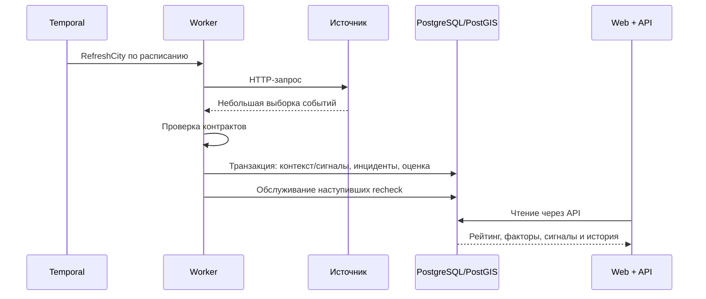
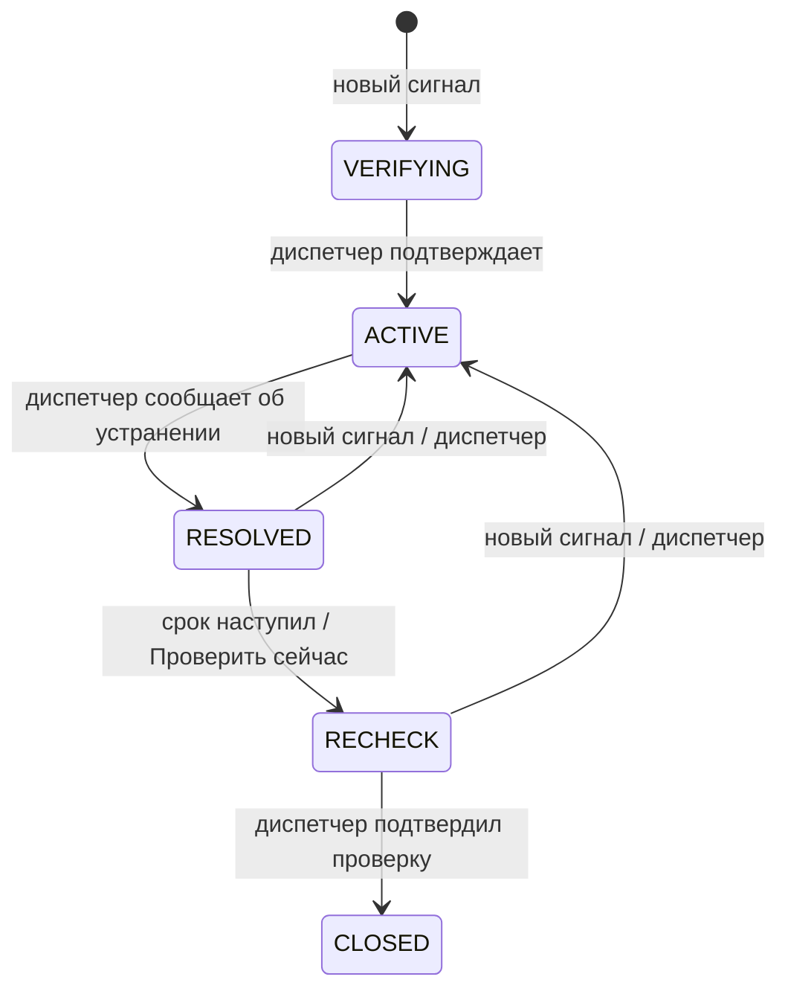

# Архитектура MVP

«Тёплый маршрут» — локальный прототип поддержки решений городского диспетчера. Он собирает сигналы, связывает их с участками Тюмени, объединяет в инциденты, рассчитывает Impact Score и позволяет подтвердить проблему, отметить устранение и проверить результат.

Реализован полный контур: Web Dashboard, Backend API, Background Worker, база данных и моки источников. Весь исполняемый код и конфигурация находятся в `mvp/`. Инструкция запуска — в [README MVP](../mvp/README.md).

## Схема системы



## Ответственность компонентов

| Компонент | Ответственность |
|---|---|
| Web Dashboard | Карта, рейтинг и фильтр статусов, карточка проблемы, факторы оценки, сигналы, история, формы обращения и решения диспетчера |
| Backend API | Валидация HTTP-запросов, чтение данных, приём обращений, изменение статусов, раздача собранного веба |
| Общая бизнес-логика | Геопривязка, дедупликация, объединение инцидентов, допустимые переходы, повторная проверка, расчёт оценки |
| Background Worker | Загрузка источников, вызовы общей обработки, периодический пересчёт и выполнение наступивших повторных проверок |

## Обработка



## Жизненный цикл



## Impact Score


```text
Score = 100 × (0.35H + 0.25M + 0.20T + 0.10D + 0.10C)
```

| Фактор | Расчёт |
|---|---|
| H — опасность | Максимум базовой опасности (ice 0.9, snow 0.6, delay 0.4) и погодного риска |
| M — мобильность | Индекс потока 0–1 |
| T — транспортная значимость | Максимум критичности сегмента и нормализованной задержки |
| D — длительность | Время с регистрации начала инцидента в долях суток, ограниченное диапазоном 0–1 |
| C — достоверность | 0.25 без свежих сообщений, 0.5 при одном, затем +0.25 за дополнительный уникальный текст, максимум 1 |