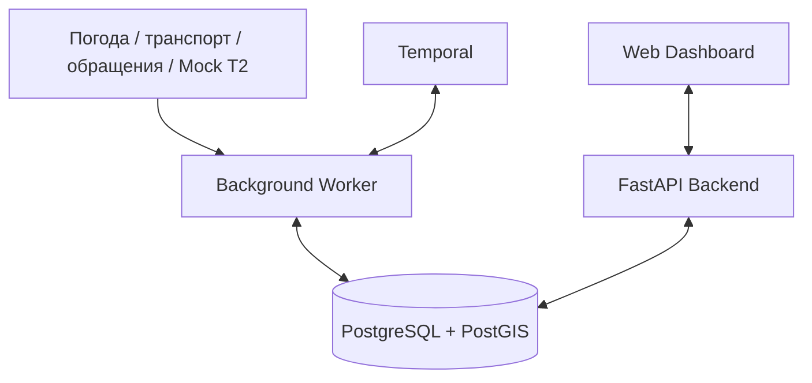
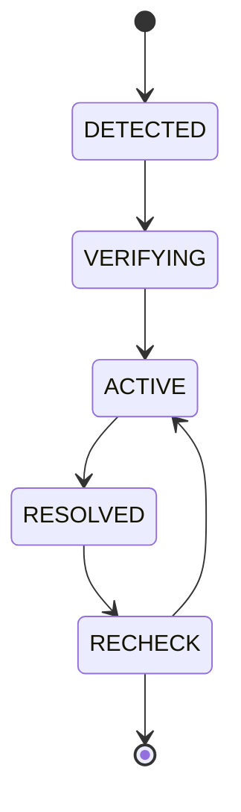

# T2 «Тёплый маршрут» — архитектура MVP
## 1. Назначение MVP

MVP демонстрирует систему, которая объединяет городские данные и определяет приоритетность зимних проблем с учётом их влияния на мобильность жителей Тюмени.

Основные возможности:

- Сбор погодных, транспортных и пользовательских данных.
- Обнаружение и обработка проблемных участков.
- Расчёт Impact Score.
- Отображение проблем и их приоритетов на карте.
- Управление статусами инцидентов.
- Автоматический пересчёт при изменении ситуации.

В MVP используются открытые, подготовленные и синтетические данные. Реальная геоаналитика T2 требует отдельной интеграции.

## 2. Общая архитектура

Система состоит из трёх основных компонентов:

| Компонент | Назначение |
|---|---|
| **Backend API** | Бизнес-логика, обработка инцидентов, расчёт Impact Score и REST API |
| **Background Worker** | Загрузка данных, периодические проверки и фоновые задачи |
| **Web Dashboard** | Карта проблем, рейтинг приоритетов и управление инцидентами |

Инфраструктура:

- **PostgreSQL + PostGIS** — хранение данных и пространственные запросы.
- **Temporal** — управление фоновыми процессами.

Backend и Worker используют общие Python-модули. Отдельные микросервисы для бизнес-функций не создаются.

## 3. Компоненты

### 3.1. Backend API

**Технология:** Python + FastAPI

Основной сервер приложения.

Внутренние модули:

| Модуль | Ответственность |
|---|---|
| **Signal Processing** | Нормализация данных, классификация обращений, географическая привязка и дедупликация |
| **Incident Management** | Создание, обновление и управление статусами проблем |
| **Impact Score Engine** | Расчёт приоритетности и объяснение факторов индекса |

Backend предоставляет REST API для работы с картой, инцидентами, сигналами и результатами оценки.

### 3.2. Background Worker

**Технология:** Python + Temporal SDK

Выполняет фоновые операции:

- Загрузка данных из внешних источников.
- Периодическое обновление погодных и транспортных сведений.
- Обработка поступивших сигналов.
- Пересчёт Impact Score.
- Повторная проверка инцидентов.

Для каждого источника используется отдельный адаптер. Повторная обработка одного события не должна создавать дубликаты.

Temporal отвечает за выполнение задач, повторные попытки после ошибок и управление жизненным циклом фоновых операций.

### 3.3. PostgreSQL + PostGIS

**Технологии:** PostgreSQL, PostGIS, SQLAlchemy, Alembic

Единая база данных приложения.

Основные сущности:

| Сущность | Назначение |
|---|---|
| `Segment` | Остановка, переход или участок дороги |
| `Incident` | Зарегистрированная городская проблема |
| `Signal` | Обращение, погодное или транспортное событие |
| `ImpactScore` | Результат оценки и значения факторов |
| `MobilitySnapshot` | Агрегированный показатель мобильности |

PostGIS используется для географической привязки сигналов, поиска ближайших сегментов и пространственных запросов.

### 3.4. Web Dashboard

**Технологии:** React + TypeScript + Leaflet

Веб-интерфейс для визуализации и управления проблемами.

Основные функции:

- Интерактивная карта Тюмени.
- Отображение проблемных участков.
- Цветовая индикация Impact Score.
- Рейтинг инцидентов по приоритетности.
- Карточка проблемы с объяснением расчёта.
- Изменение статуса инцидента.

Для MVP достаточно одного интерфейса диспетчера. 

## 4. Impact Score

**Impact Score** — индекс влияния городской проблемы на мобильность жителей.

Основные факторы:

- Опасность проблемы.
- Интенсивность потока людей.
- Транспортная критичность участка.
- Длительность проблемы.
- Достоверность сигналов.

Индекс рассчитывается по детерминированной формуле с нормализованными факторами и настраиваемыми весами.

Результат содержит итоговое значение от 0 до 100 и объяснение вклада каждого фактора.

В MVP показатель мобильности моделируется синтетическими данными. В дальнейшем он может быть заменён агрегированной геоаналитикой T2.

## 5. Обработка инцидентов

Жизненный цикл проблемы:

Основной поток обработки:

1. Worker загружает данные.
2. Signal Processing нормализует сигналы и определяет городской сегмент.
3. Incident Management создаёт или обновляет инцидент.
4. Impact Score Engine рассчитывает приоритет.
5. Результат сохраняется в PostgreSQL.
6. Dashboard отображает актуальное состояние.
7. При поступлении новых данных индекс пересчитывается.

## 6. Технологический стек

| Область | Технологии |
|---|---|
| Backend | Python, FastAPI |
| Асинхронная обработка | asyncio, httpx |
| База данных | PostgreSQL, PostGIS |
| ORM и миграции | SQLAlchemy, Alembic |
| Фоновые процессы | Temporal Python SDK |
| Frontend | React, TypeScript, Leaflet |
| Тестирование | pytest |
| Контейнеризация | Docker Compose |

## 7. Границы MVP

**Входит в MVP:**

- Загрузка подготовленных и доступных внешних данных.
- Создание и обработка инцидентов.
- Расчёт Impact Score.
- Карта и рейтинг проблем.
- Изменение статусов.
- Автоматический пересчёт индекса.

**Не входит в MVP:**

- Уведомления и подписки.
- Отдельное пользовательское приложение.
- Полноценная маршрутизация.
- Реальная интеграция с Big Data T2.
- IoT-датчики и M2M.
- Интеграция с закрытыми муниципальными системами.

Уведомления жителей остаются частью целевой продуктовой концепции, но в текущей версии не реализуются.

---

**Результат MVP:** работающий прототип, демонстрирующий полный цикл от получения информации о городской проблеме до её оценки, приоритизации и отображения на карте.
