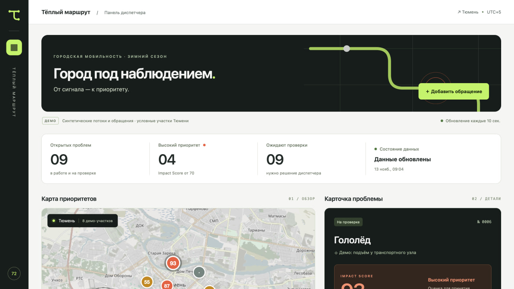
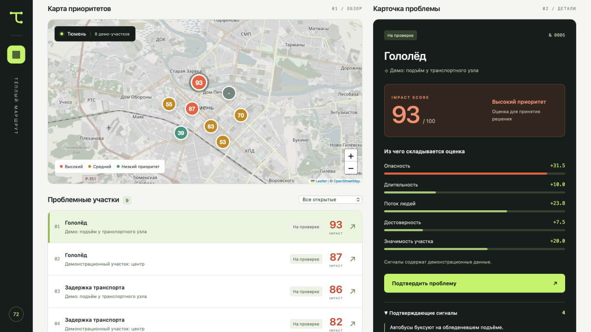
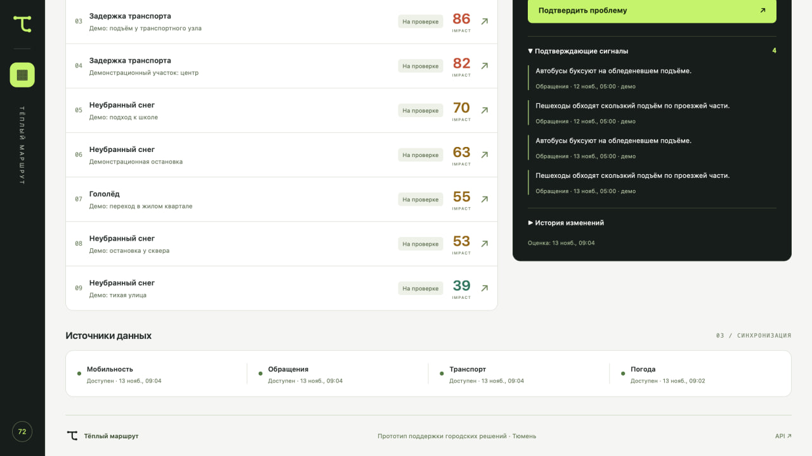

# Запуск и проверка MVP

MVP включает веб-интерфейс диспетчера, REST API, Temporal Worker, PostgreSQL/PostGIS и демонстрационные HTTP-источники. Все команды ниже выполняются из каталога `mvp/`, если явно не указан другой каталог.

## Первый запуск

Скачайте или клонируйте репозиторий, откройте терминал в его корне и перейдите в `mvp`:

```sh
cd mvp
```

Создайте локальные настройки в `.env`:

```sh
cp .env.example .env
```
| Переменная `.env` | По умолчанию | Назначение |
|---|---|---|
| `WEATHER_PROVIDER` | `mock` | `mock` или `open_meteo` |
| `POLL_SECONDS` | `60` | Интервал Workflow, минимум 10 секунд |
| `RECHECK_SECONDS` | `1800` | Задержка повторной проверки, минимум 1 секунда |

Соберите и запустите приложение:

```sh
docker compose up --build -d
docker compose ps -a
```

Ожидаемое состояние: `db` и `temporal` — `healthy`, `api`, `worker`, `mocks` — `Up`, `init` — `Exited (0)`. Завершение init нормально: он применяет миграции и добавляет сегменты, после чего больше не нужен до следующего запуска.

Откройте:

- [Веб-интерфейс](http://localhost:8000/)
- [Swagger API](http://localhost:8000/docs)
- [Проверку API и БД](http://localhost:8000/health) — ожидается `{"status":"ok"}`

## Тесты

### Сервер и интеграции

После запуска Compose выполните из `mvp/`:

```sh
docker compose run --rm -e RUN_INTEGRATION=1 -v ./tests:/code/tests:ro api python -m unittest discover -s tests -v
```

Для быстрых тестов без Docker нужны Python 3.12 и зависимости:

```sh
python3.12 -m venv .venv
.venv/bin/pip install -r requirements.txt
.venv/bin/python -m unittest discover -s tests -v
```

### Сборка и браузерные сценарии

Для локальной проверки веба нужны Node.js 22, npm и установленный Google Chrome. Само приложение должно работать на `http://localhost:8000`.

```sh
cd web
npm ci
npm run build
npm test -- --workers=1
```

## Скриншоты интерфейса

### Панель диспетчера



### Карта приоритетов и карточка проблемы



### Подтверждающие сигналы и источники данных


